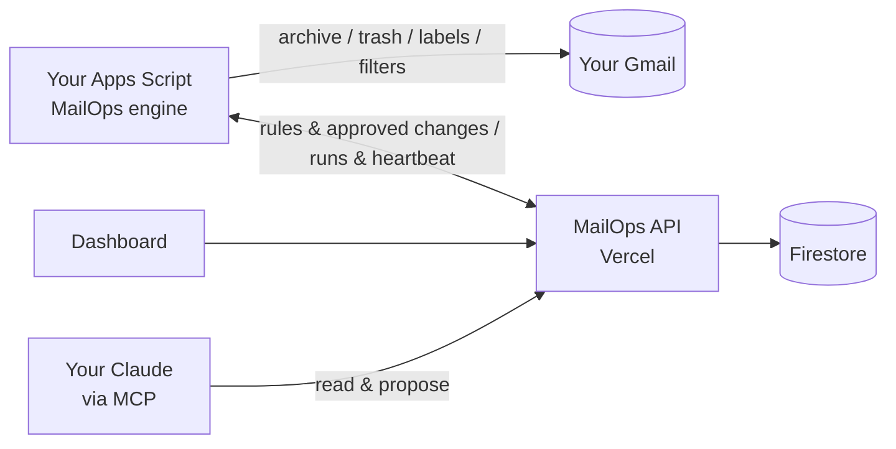

# MailOps

**Open-source Gmail automation, without handing your inbox to a server.**

MailOps keeps Gmail tidy with simple per-label rules: _archive after N days_, _move to Trash after M days_, or _keep forever_. You manage everything from a clean web dashboard, or from **Claude**, through the MailOps MCP server.

> **Status: early development.** The Gmail engine has run in production for a single user since Sept 2026. The multi-user web app is being built in the open. See the [roadmap](docs/roadmap.md).

## How it works



- **Your Gmail stays yours.** The engine runs as an Apps Script in _your_ Google account. The web app only uses basic Google sign-in and never gets Gmail access.
- **Safe by default.**
  - dry run first
  - move to Trash, never permanent delete
  - starred, Important and `Keep`-labelled mail is never touched
  - every change made from the web or Claude is a **proposal you approve**.
- **Free to run.** Fits the Firebase Spark and Vercel Hobby free tiers, and Apps Script quotas. Self-host with your own Firebase and Vercel.
- **Claude-native.** Ask Claude to _"add a rule that trashes promo mail from my bank after 90 days"_. It proposes; you approve in the dashboard.

## Repository

| Path                                 | What                                                             |
| ------------------------------------ | ---------------------------------------------------------------- |
| [`apps/web`](apps/web)               | Next.js dashboard, API routes, MCP endpoint (Vercel)             |
| [`engine`](engine)                   | Apps Script library that runs in each user's account             |
| [`packages/schema`](packages/schema) | Shared zod schemas: rules, settings, proposals                   |
| [`firebase`](firebase)               | Firestore security rules and indexes                             |
| [`docs`](docs)                       | [Architecture](docs/architecture.md), [roadmap](docs/roadmap.md) |

## Development

```bash
corepack pnpm install
corepack pnpm check      # format + typecheck + tests (same as CI)
```

See [CONTRIBUTING.md](CONTRIBUTING.md). Security issues: see [SECURITY.md](SECURITY.md).

## License

[MIT](LICENSE)
