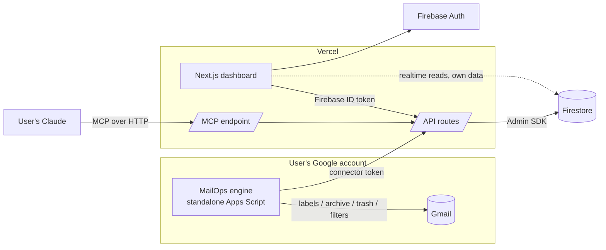

# Architecture

## The key decision: who touches Gmail?

A hosted service that reads and changes _other people's_ Gmail must use Google's **restricted** Gmail scopes (`gmail.modify`, `gmail.settings.basic`). That means Google verification plus an annual third-party security assessment (CASA). Until approved, an app is capped at 100 users for its lifetime ([Google](https://support.google.com/cloud/answer/13463817)).

**MailOps avoids this by design:**

- **Each user's own Apps Script does the Gmail work, in their own Google account.**
- **The web app only uses basic Google sign-in.** No Gmail token ever leaves the user's account, and no verification is needed.



| Path                          | Auth                                                                                     |
| ----------------------------- | ---------------------------------------------------------------------------------------- |
| Dashboard → API               | Firebase ID token, verified by the Admin SDK                                             |
| Dashboard → Firestore (reads) | Security rules: `request.auth.uid == userId`                                             |
| Engine → API                  | **Connector token**: created in the dashboard, shown once, stored hashed, revocable      |
| Claude → MCP                  | v1: personal access token. v2: OAuth 2.1 (MCP auth spec) for claude.ai custom connectors |
| Any write to Firestore        | Server only (Admin SDK). Clients can't write                                             |

## Proposals, not remote control

The dashboard and MCP never change Gmail directly. They create **proposals**: upsert a rule, create a label, create a filter, request a dry run.

1. The user **approves** a proposal in the dashboard.
2. It becomes a **command**.
3. The engine applies it on its next sync, every 15 minutes, dry-run first where applicable, and reports the result.

MCP can read and propose. It can never approve, delete, or turn production on.

## Engine

- A **standalone Apps Script project** (no spreadsheet). Users copy a template, run `setup`, and approve a pairing code on the dashboard. See [engine/README.md](../engine/README.md).
- **Pairing**, like signing in to a TV app:

  1. The engine sends a Google identity token (`ScriptApp.getIdentityToken()`), which proves its Gmail address.
  2. It gets back a short code to show the user.
  3. The signed-in user approves that code on the dashboard.
  4. The engine polls and receives its connector token once.

  No secret is ever copied by hand.

- **Triggers:**
  - nightly lifecycle pass: archive and trash per rule, in resumable batches of up to 4 minutes, quota-aware
  - 15-minute sync: heartbeat, pull config and commands, apply them, report, mirror labels and filters (with filter health).
- **Config:** rules and settings come from the dashboard and are cached in Script Properties. If the dashboard is down, the engine keeps working from the cache; production pauses after 3 days without a fresh config.
- **Safety:**
  - dry run by default
  - move to Trash only, never permanent delete
  - global guard: starred, Important and a protected label (`Keep`) are never touched
  - Never Delete rules
  - changed rules preview first (24 h by default)
  - a per-pass trash limit
  - one bad rule never stops the whole run.

## Data model (Firestore)

One **user** (a person, signed in with Google) can manage several **mailboxes** (Gmail addresses). Each mailbox has its own rules, settings, proposals, runs and engine, because each Gmail account runs its own Apps Script engine.

```
users/{uid}                                   profile (sign-in email)
users/{uid}/mailboxes/{mailboxId}             one Gmail address: email, displayName, connected, settings
  …/rules/{ruleId}                            one per Gmail label
  …/mirror/labels, …/mirror/filters           Gmail labels and filters as reported by the engine (+ filter health)
  …/proposals/{id}                            kind, payload, source (web|mcp), status, result
  …/commands/{id}                             work for the engine: queued → sent → done | failed
  …/runs/{runId}                              mode, status, counts, engine version
  …/stats/{yyyy-mm-dd}                        one doc per day, counts per mode
  …/events/{runId_messageId_action}           audit trail; expireAt = at + retentionDays, pruned daily
  …/heartbeat/engine                          lastSeenAt, lastRunAt, status, version, engine state
connectorTokens/{sha256}                      server-only: { uid, mailboxId }; one per mailbox
pairings/{sha256(deviceCode)}                 server-only: pending engine pairings (15 min)
mcpTokens/{sha256}                            server-only: MCP personal tokens and OAuth access tokens
oauthClients/{id}, oauthCodes/…, oauthGrants/…  server-only: MCP OAuth (clients, codes, refresh tokens)
```

- `mailboxId` is a hash of the lowercased address, so the same address can't be added twice. Each user can have up to 20 mailboxes.
- A mailbox is `connected: false` until its engine checks in with that mailbox's connector token. That check-in proves the user controls the Gmail account.

**Privacy:** email bodies are never stored. Audit events keep the sender domain, label and action; subjects are opt-in per mailbox.

Schemas live in [`packages/schema`](../packages/schema) and are shared by web, API, MCP and engine.

## Free-tier fit (checked Nov 2026)

| Service                | Limit                                                                                                                       | Typical active user                                               |
| ---------------------- | --------------------------------------------------------------------------------------------------------------------------- | ----------------------------------------------------------------- |
| Firestore (Spark)      | 50K reads/day, 20K writes/day, 1 GiB ([Firebase](https://firebase.google.com/docs/projects/billing/firebase-pricing-plans)) | ~50 writes, ~200 reads/day, ~3 MB, so ~300 users per free project |
| Firebase Spark         | No Cloud Functions                                                                                                          | Not used. Server code runs on Vercel                              |
| Vercel Hobby           | Non-commercial; functions 10 s default, up to 60 s ([Vercel](https://vercel.com/docs/plans/hobby))                          | Short API calls only; scheduling is in Apps Script                |
| Apps Script (consumer) | 6 min/execution, 90 min/day triggers, 20K UrlFetch/day ([Google](https://developers.google.com/apps-script/quotas))         | ~4 min nightly + ~3 min of syncs/day                              |

Self-hosting gives each deployment its own quotas. A commercial hosted instance needs Vercel Pro.

## Monitoring

- The engine heartbeat is updated on every sync. The dashboard shows **STALE** after 26 h.
- The engine emails the user (from their own account) on a failed run, or when the nightly pass is overdue.
- A daily Vercel Cron (`/api/cron/monitor`) flags engines that stopped checking in. This catches a dead engine that can't email anyone. It emails through Resend if `RESEND_API_KEY` is set.
- Old audit events are pruned by the API (about once a day per mailbox). This works on the free Spark plan, where Firestore TTL policies aren't available.
