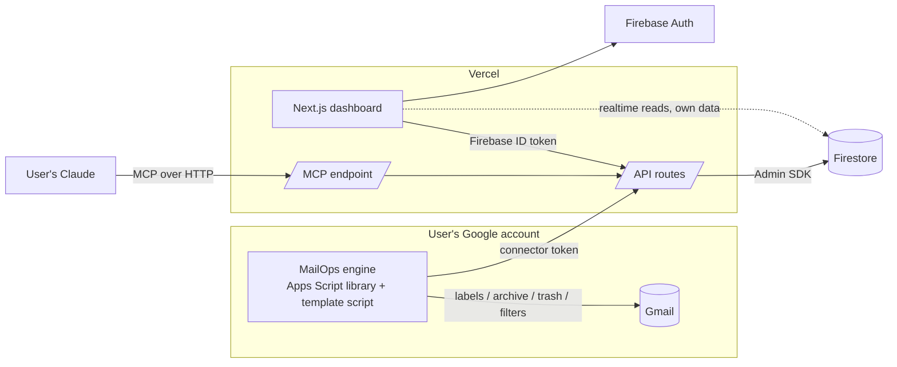

# Architecture

## The key decision: who touches Gmail?

A hosted service that reads and changes _other people's_ Gmail must use Google's **restricted** Gmail scopes (`gmail.modify`, `gmail.settings.basic`). That means Google verification plus an annual third-party security assessment (CASA). Until approved, an app is capped at 100 users for its lifetime ([Google](https://support.google.com/cloud/answer/13463817)).

**MailOps avoids this by design:**

- **Each user's own Apps Script does the Gmail work, in their own Google account.**
- **The web app only uses basic Google sign-in.** No Gmail token ever leaves the user's account, and no verification is needed.



| Path                          | Auth                                                                                     |
| ----------------------------- | ---------------------------------------------------------------------------------------- |
| Dashboard → API               | Firebase ID token, verified by the Admin SDK                                             |
| Dashboard → Firestore (reads) | Security rules: `request.auth.uid == userId`                                             |
| Engine → API                  | **Connector token**: created in the dashboard, shown once, stored hashed, revocable      |
| Claude → MCP                  | v1: personal access token. v2: OAuth 2.1 (MCP auth spec) for claude.ai custom connectors |
| Any write to Firestore        | Server only (Admin SDK). Clients can't write                                             |

## Proposals, not remote control

The dashboard and MCP never change Gmail directly. They create **proposals**: upsert a rule, create a label, create a filter, request a dry run.

1. The user **approves** a proposal in the dashboard.
2. It becomes a **command**.
3. The engine applies it on its next sync, every 15 minutes, dry-run first where applicable, and reports the result.

MCP can read and propose. It can never approve, delete, or turn production on.

## Engine

- An Apps Script **library**. Users copy a small template that calls it, then paste their connector token.
- **Triggers:**
  - nightly lifecycle run: archive / trash per rule, resumable batches, quota-aware
  - 15-minute sync: heartbeat, pull config and commands, apply, report.
- **Safety:**
  - dry run by default
  - move to Trash only, never permanent delete
  - global guard: starred, Important and a protected label (`Keep`) are never touched
  - Never Delete rules
  - one bad rule never stops the whole run.

## Data model (Firestore)

```
users/{uid}                          profile, settings
users/{uid}/rules/{ruleId}           one per Gmail label
users/{uid}/labels/{labelId}         mirrored from Gmail by the engine
users/{uid}/filters/{filterId}       mirrored + health (matches vs labelled, 30 days)
users/{uid}/proposals/{id}           kind, payload, source (web|mcp), status
users/{uid}/runs/{runId}             mode, status, counts, engine version
users/{uid}/stats/{yyyy-mm-dd}       one doc per day, counts by label
users/{uid}/events/{id}              audit trail, pruned after retentionDays (default 90)
users/{uid}/heartbeat/engine         lastSeenAt, lastRunAt, status, version
connectorTokens/{sha256}             server-only
mcpTokens/{sha256}                   server-only
```

**Privacy:** email bodies are never stored. Audit events keep the sender domain, label and action; subjects are opt-in per user.

Schemas live in [`packages/schema`](../packages/schema) and are shared by web, API, MCP and engine.

## Free-tier fit (checked Nov 2026)

| Service                | Limit                                                                                                                       | Typical active user                                               |
| ---------------------- | --------------------------------------------------------------------------------------------------------------------------- | ----------------------------------------------------------------- |
| Firestore (Spark)      | 50K reads/day, 20K writes/day, 1 GiB ([Firebase](https://firebase.google.com/docs/projects/billing/firebase-pricing-plans)) | ~50 writes, ~200 reads/day, ~3 MB, so ~300 users per free project |
| Firebase Spark         | No Cloud Functions                                                                                                          | Not used. Server code runs on Vercel                              |
| Vercel Hobby           | Non-commercial; functions 10 s default, up to 60 s ([Vercel](https://vercel.com/docs/plans/hobby))                          | Short API calls only; scheduling is in Apps Script                |
| Apps Script (consumer) | 6 min/execution, 90 min/day triggers, 20K UrlFetch/day ([Google](https://developers.google.com/apps-script/quotas))         | ~4 min nightly + ~3 min of syncs/day                              |

Self-hosting gives each deployment its own quotas. A commercial hosted instance needs Vercel Pro.

## Monitoring

- The engine heartbeat is updated on every sync. The dashboard shows **STALE** after 26 h.
- The engine emails the user (from their own account) on a failed run, or when the nightly run is overdue.
- Retention pruning runs inside the engine's sync, so no server cron is needed.
